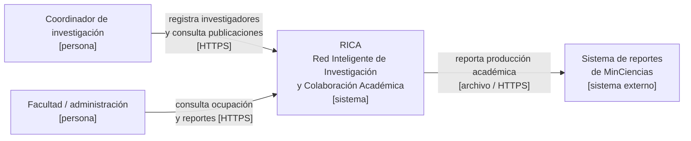
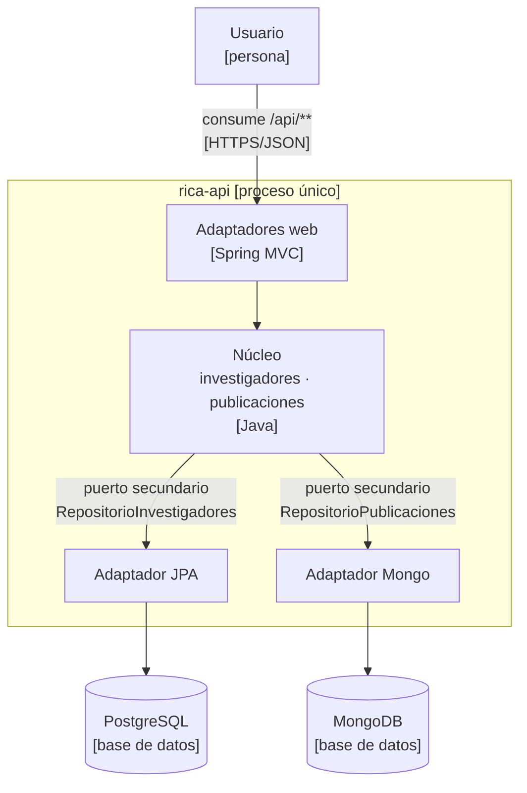
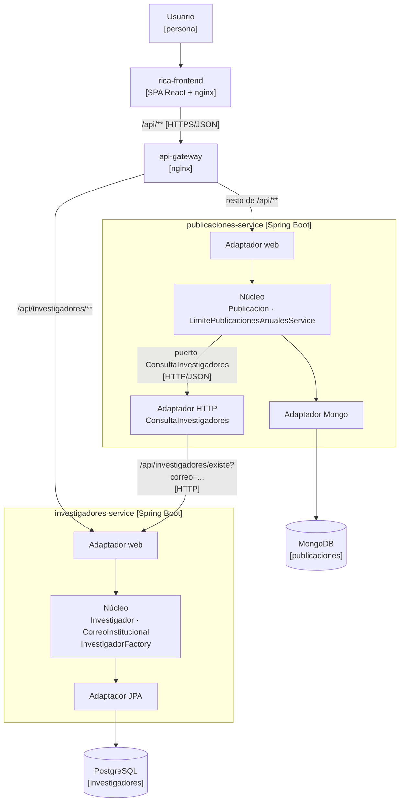

# Diagramas C4 — RICA

Diagramas de **Contexto** (nivel 1) y **Contenedores** (nivel 2) del proyecto, en el
estado que quedó tras la Lección 5. Se dibujan con Mermaid para que vivan en el mismo
repositorio que el código.

## Contexto (nivel 1)

## Contenedores (nivel 2) — estado tras la Lección 4

Un solo proceso desplegable (monolito modular hexagonal): los dos Bounded Contexts viven en
el mismo artefacto y se llaman en memoria.

## Contenedores (nivel 2) — estado tras la Lección 5

Dos procesos independientes, cada uno con su base de datos, y una fachada que conserva el
punto de entrada.

